# Ilmajaam ESP-01S mikrokontrolleril (HU-061 komplekt)

**Autorid:** Tanel Metshein, Uku Siim Kurm
**Juhendaja:** Tanel Toova
**Projekti algus:** 2026-10-21 · **Viimati uuendatud:** 2026-11-11 · **Tunnipäevik:** [vt allpool](#tunnipäevik)

Püsivara HU-061 ilmakella jootmiskomplektile (ESP-01S + 0,96" OLED). Seade toob OpenWeatherMapist valitud linna ilmaandmed ning kuvab need ekraanil ja veebilehel. WiFi, linna ja API võtme saab seadistada brauseris, ilma püsivara uuesti üles laadimata.

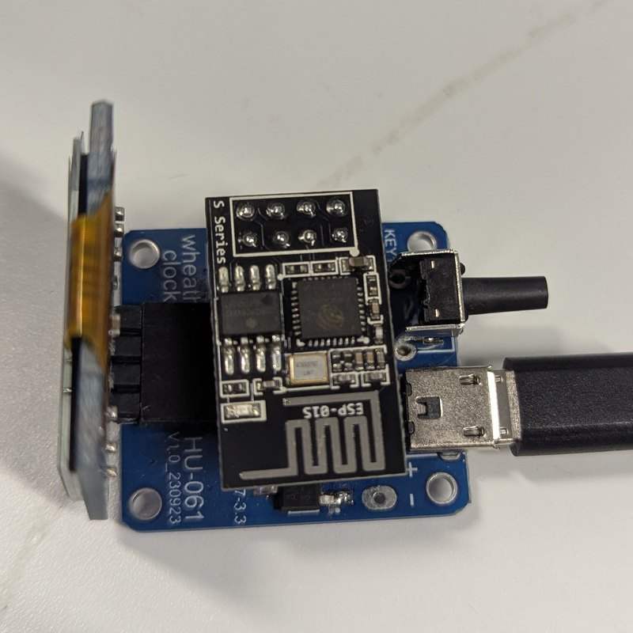

## Sisukord

- [Kiirstart](#kiirstart)
- [Projekti eesmärk](#projekti-eesmärk)
- [Komponendid](#komponendid)
- [Kontroller ja viigud](#kontroller-ja-viigud)
- [Sisendid ja väljundid](#sisendid-ja-väljundid)
- [Toide, side ja andmete hoidmine](#toide-side-ja-andmete-hoidmine)
- [Nõuded](#nõuded)
- [Ühendusskeem](#ühendusskeem)
- [Turvalisus](#turvalisus)
- [Veaotsing](#veaotsing)
- [Teadaolevad piirangud](#teadaolevad-piirangud)
- [Dokumentatsioon ja andmelehed](#dokumentatsioon-ja-andmelehed)
- [Tunnipäevik](#tunnipäevik)
- [Koodinäide](#koodinäide)

## Kiirstart

### 1. Arduino IDE ettevalmistus (ühekordne)

1. **File → Preferences → Additional boards manager URLs:**
   `http://arduino.esp8266.com/stable/package_esp8266com_index.json`
2. **Boards Manager:** paigalda *esp8266 by ESP8266 Community* (testitud versiooniga 3.1.2).
3. **Library Manager:** paigalda
   - *ArduinoJson* (Benoit Blanchon, v6 või v7)
   - *NTPClient* (Fabrice Weinberg)
   - *ESP8266 and ESP32 OLED driver for SSD1306 displays* (ThingPulse, v4.x)
4. **Tools:**

   | Seade | Väärtus |
   |---|---|
   | Board | Generic ESP8266 Module |
   | Flash Size | 1MB (FS:64KB OTA:~470KB) — failisüsteem peab olema valitud |
   | Upload Speed | 115200 |

### 2. Püsivara üleslaadimine

ESP-01S-il pole USB-pesa, seega laaditakse püsivara ESP-01 USB-programmaatoriga (CH340, lüliti UART/PROG).

1. Võta ESP-01S HU-061 plaadilt ära ja pane programmaatorisse nii, et moodul jääb programmaatori kohale.
2. Lülita lüliti asendisse **PROG** ja ühenda programmaator USB-sse. Lüliti asendit loetakse ainult käivitusel, seega pärast lülitamist ühenda programmaator uuesti.
3. Ava [`code/weather_station.ino`](code/weather_station.ino). Arduino IDE nõuab, et sketš oleks samanimelises kaustas, ja pakub kausta `weather_station` loomist. Vajuta **OK**. Seejärel vali õige COM-port ja vajuta **Upload**. Üleslaadimine õnnestus, kui väljundis on `Hash of data verified` ja viimasena `Hard resetting via RTS pin...` (sellele rohkem ridu ei järgne).
4. Pane ESP-01S tagasi HU-061 plaadile samas suunas ja ühenda plaat USB-toitega.

> Üleslaadimine kustutab komplekti tehase püsivara. Varukoopia saad enne teha käsuga
> `esptool.py --port COM3 read_flash 0 0x100000 varu.bin`.

### 3. Esmane seadistamine

1. Tasuta API võtme saad [openweathermap.org](https://home.openweathermap.org/api_keys) kontolt. Uus võti hakkab tööle mõne tunni jooksul.
2. Seadistuste puudumisel avab seade WiFi-võrgu **`ESP_AP`**. Võrgu nimi, parool ja aadress on ekraanil.
3. Ühendu sellega telefonist. Seadistusleht avaneb ise või aadressil `http://192.168.4.1`.
4. Sisesta WiFi nimi ja parool, linn (nt `Tartu,EE`) ja API võti, seejärel **Salvesta**.
5. Seade taaskäivitub ja ühendub võrku. Edaspidi on veebiliides aadressil `http://ilmajaam.local` või ekraanil näidatud IP-aadressil.

Seadistuste kustutamiseks hoia nuppu **KEY1** 5 sekundit all.

### 4. Ilmaandmete ajalugu Google Sheetsis (valikuline)
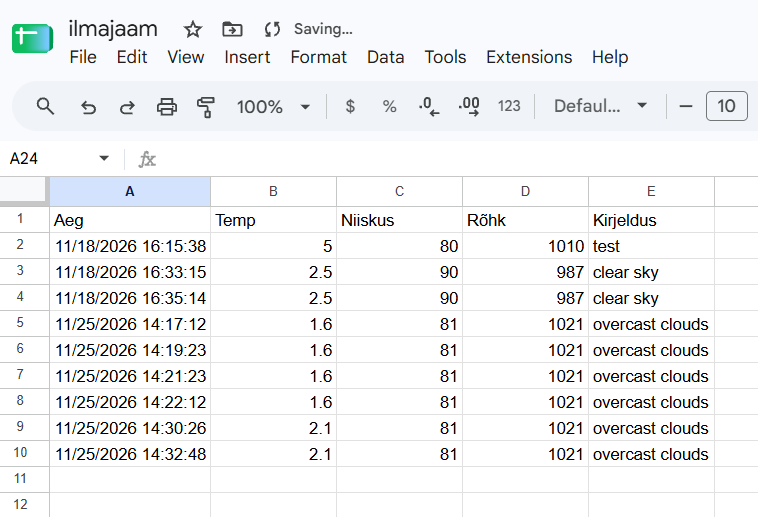

Pärast iga eduka ilmapäringu (vaikimisi iga 10 min) lisab seade Google Sheeti tabelisse uue rea: aeg, temperatuur, niiskus, rõhk ja kirjeldus.

1. Loo Google Sheet ja kirjuta rea 1 lahtritesse A1–E1 pealkirjad: `Aeg`, `Temp`, `Niiskus`, `Rõhk`, `Kirjeldus`.
2. Ava **Extensions → Apps Script**, kustuta vaikekood ja kleebi:

   ```js
   function doGet(e) {
     var p = e.parameter;
     if (p.key !== "MINU_SALAJANE_VÕTI") return ContentService.createTextOutput("no");
     SpreadsheetApp.getActiveSheet().appendRow([new Date(), p.temp, p.hum, p.press, p.desc]);
     return ContentService.createTextOutput("ok");
   }
   ```

   Asenda `MINU_SALAJANE_VÕTI` enda valitud juhusliku tähtede-numbrite reaga.
3. **Deploy → New deployment → Web app**, *Execute as:* **Me**, *Who has access:* **Anyone**. Kinnita load ja kopeeri `/exec`-lõpuline aadress.
4. Kontrolli brauseris: `AADRESS?key=VÕTI&temp=5&hum=80&press=1010&desc=test` peab vastama `ok` ja tabelisse tekib rida.
5. Pane aadress ja võti faili [`code/weather_station.ino`](code/weather_station.ino) konstantidesse `SHEET_URL` ja `SHEET_KEY`, siis lae püsivara üles. Kuni `SHEET_URL` sisaldab sõna `EXAMPLE`, on logimine välja lülitatud.
6. Serial monitoris peab pärast iga päringut olema rida `[SHEET] HTTP 200`.

> Ära pane päris aadressi ega võtit Giti. Skripti muutmisel kasuta **Deploy → Manage deployments → Edit → New version**, siis aadress ei muutu.

## Projekti eesmärk

Ehitada ESP8266-põhine ilmajaam, mis:

- toob OpenWeatherMap API-st valitud linna ilmaandmed;
- võimaldab WiFi, linna ja API võtme muutmist brauseris, ilma püsivara uuesti üles laadimata;
- taastab pärast voolukatkestust ise WiFi-ühenduse, laadib salvestatud seadistused ja jätkab tööd.

Seadmel pole andureid, kõik ilmaandmed tulevad internetist.

## Komponendid

### HU-061 komplekt

Komplekti ametlik nimi on *HU-061 天气预报时钟制作套件 (时区)*, ehk ilmaennustuskella valmistamise komplekt ajavööndi toega (*Weather forecast clock production kit*). Pakendi partii on `B19-35-A-03` / `FADB0005-001`, pakitud 2024-03-29. Trükkplaadi märgistus on `wheather clock HU-061 V1.0_230923`. Komponentide nimetused ja tähised on [tootja juhendi](http://myosuploads3.banggood.com/products/20240423/20240423034843HU-061WeatherClock.pdf) järgi.

| Pilt ja mudel | Tähis | Komponent | Kogus | Otstarve |
|---|---|---|---|---|
| 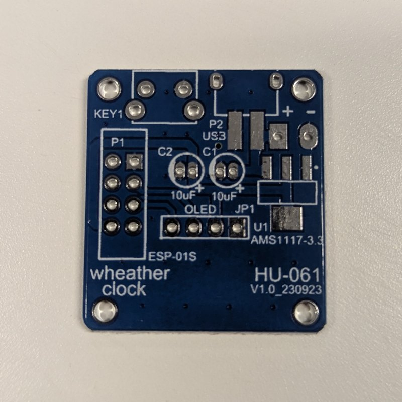<br><sub>HU-061 V1.0_230923</sub> | – | Trükkplaat | 1 | Kõik ühendused, väliseid juhtmeid pole |
| 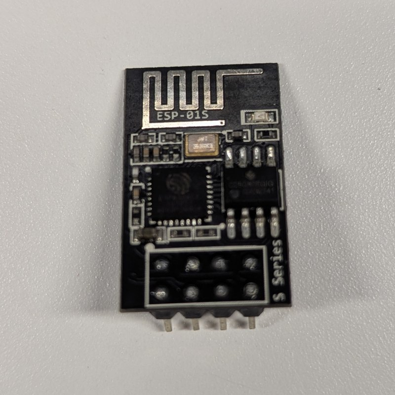<br><sub>Ai-Thinker ESP-01S (ESP8266EX)</sub> | P1 | WiFi-moodul, 1 MB välkmälu, 2×4 kontaktiga | 1 | Kontroller, WiFi, veebiserver |
| 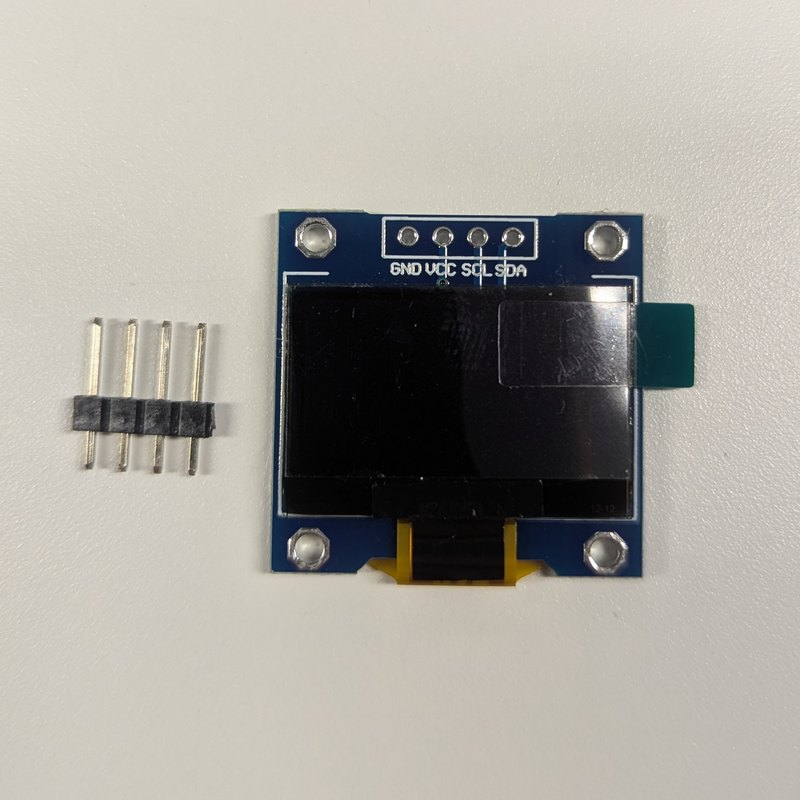<br><sub>O96B4-small, SSD1306</sub> | JP1 | 0,96" OLED-moodul, 128×64, I²C (aadress 0x3C), kontaktid GND-VCC-SCL-SDA, koos 1×4 isasliistuga | 1 | Ilmaandmete ja oleku kuvamine |
| 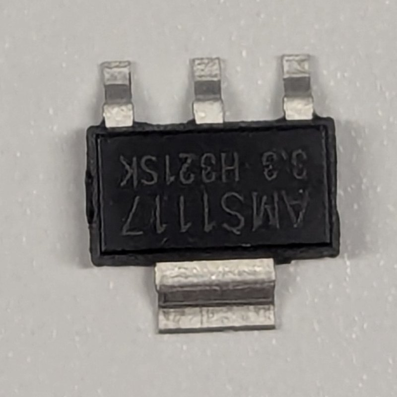<br><sub>AMS1117-3.3 (märgistus H321SK)</sub> | U1 | Lineaarne pingeregulaator, SOT-223, kuni 1 A | 1 | 5 V → 3,3 V |
| 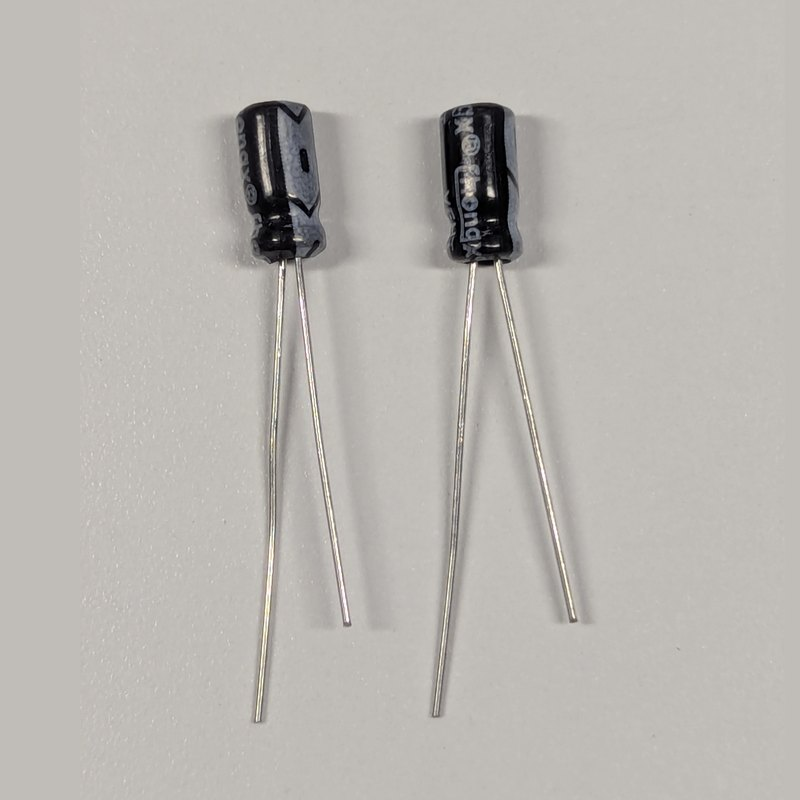<br><sub>10 µF</sub> | C1, C2 | Elektrolüütkondensaator, läbiv montaaž | 2 | Toite silumine regulaatori sisendis ja väljundis. Pikk jalg on pluss |
| 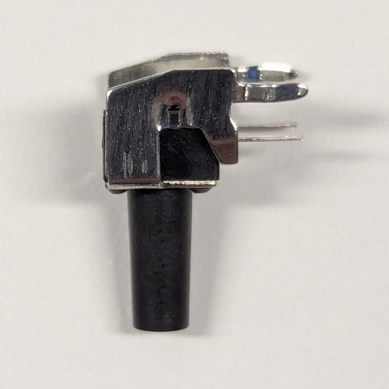<br><sub>Horizontal button (卧式按键)</sub> | KEY1 | Horisontaalne külgnupp pika nupuvarrega, läbiv montaaž | 1 | Seadistuste kustutamine |
| 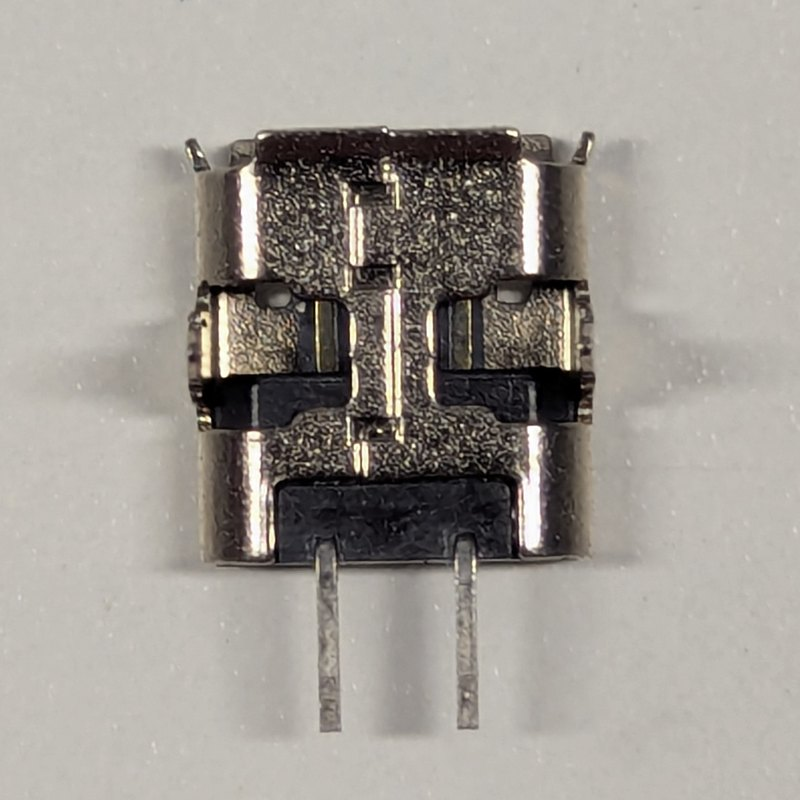<br><sub>USB interface (USB 接口), micro-USB</sub> | P2 | Micro-USB pesa ainult toitekontaktidega (VBUS, GND) | 1 | 5 V toide |
| 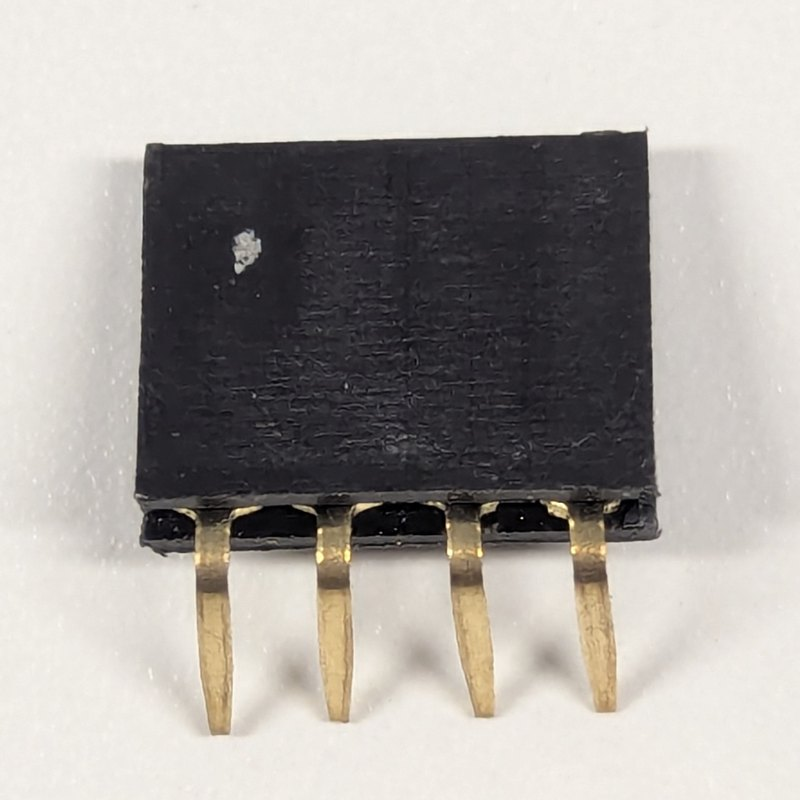<br><sub>Bent foot single row 4P socket (弯脚单排4P母座)</sub> | JP1 | Üherealine 4-kontaktiline nurgaga emaspesa, samm 2,54 mm | 1 | OLED-i püstine ühendamine |
| 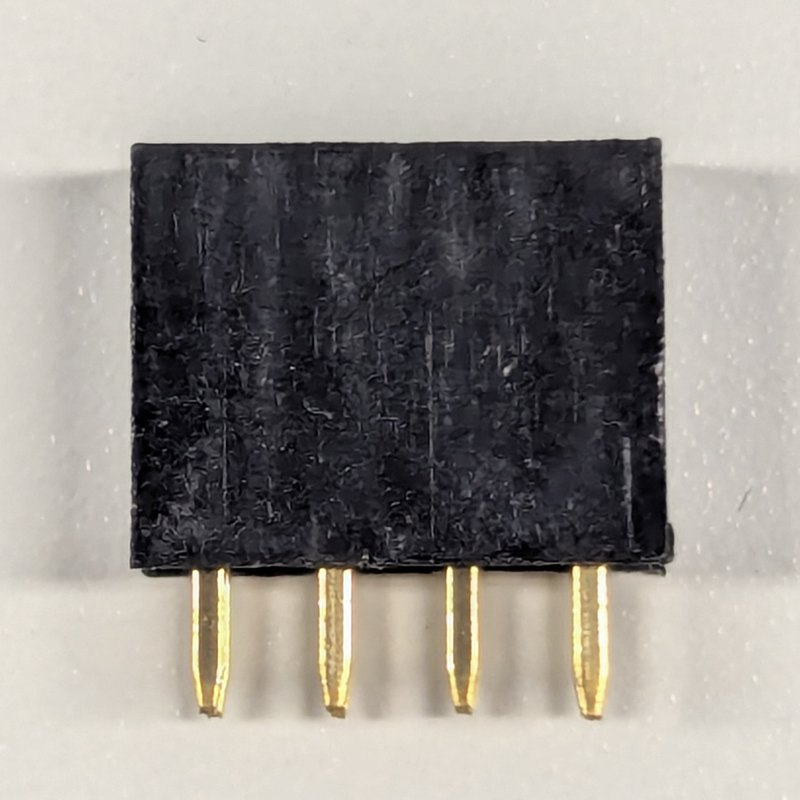<br><sub>Double row 4P socket (双排4P母座)</sub> | P1 | Kaherealine 2×4 emaspesa, samm 2,54 mm | 1 | ESP-01S eemaldatav ühendamine |
| 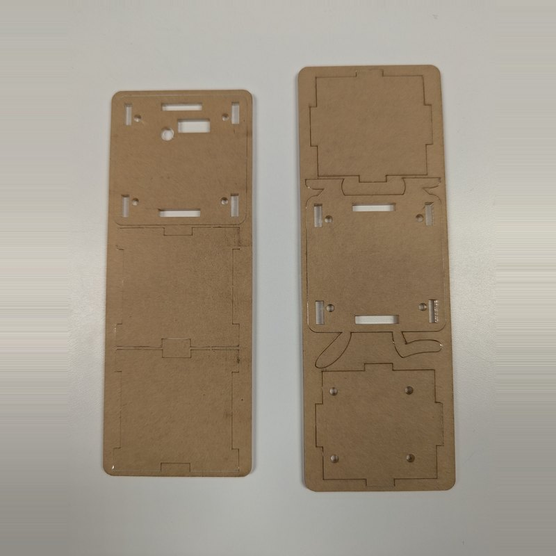<br><sub>Akrüülpaneelid (kaitsekilega)</sub> | – | Laserlõigatud akrüülkorpus, 2 plaati detailidega | 1 kmpl | Korpus |
| 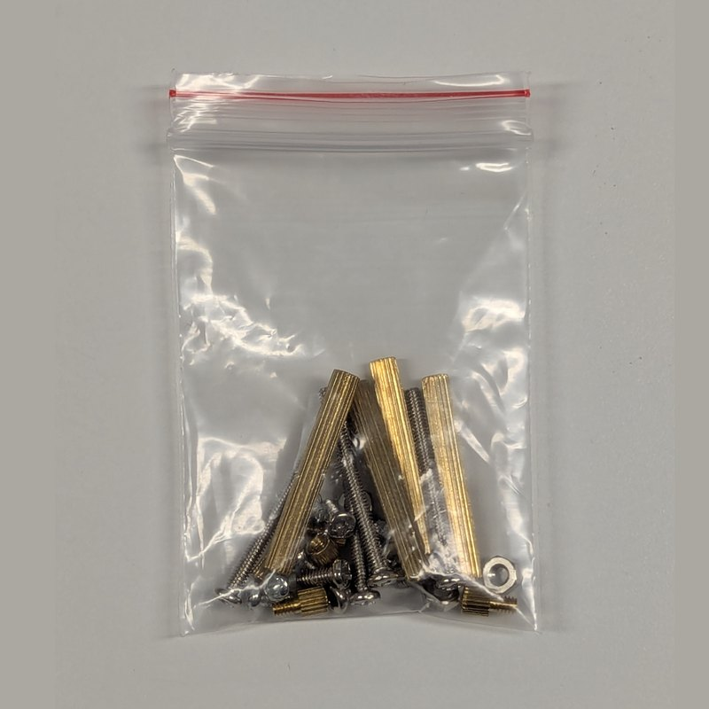<br><sub>M2 kruvid, mutrid, distantspostid</sub> | – | Messingist distantspostid (pikad ja lühikesed), kruvid ja mutrid | 1 kmpl | Korpuse ja plaadi kokkupanek |
| 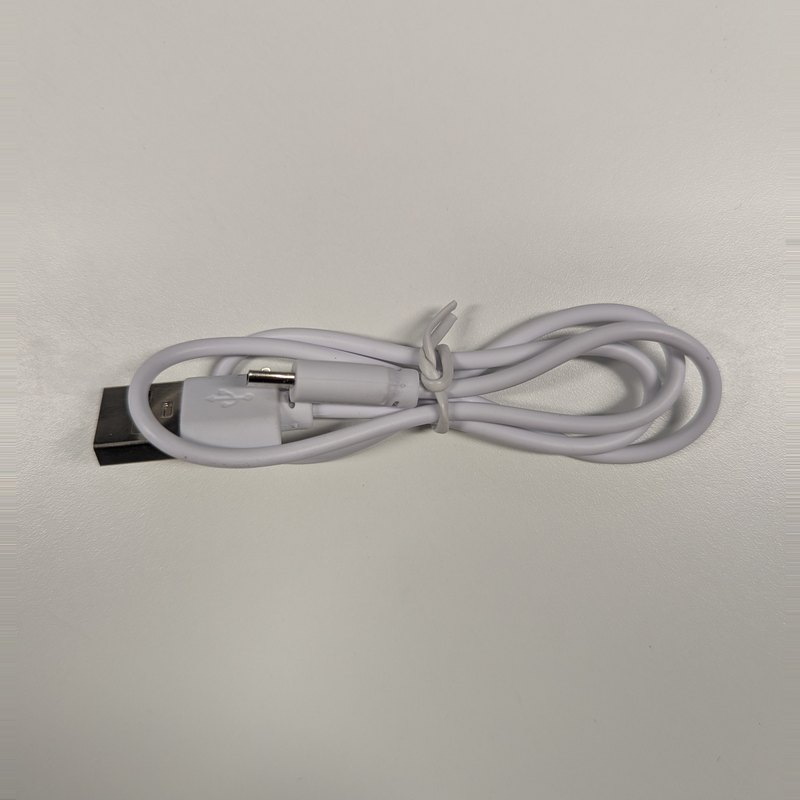<br><sub>USB-A toitekaabel</sub> | – | Toitekaabel | 1 | Toide arvutist või USB-adapterist |

Skeemil on ka `BAT1`, kuid komplektis seda pole ja seade töötab ainult USB-toitel. Komplektis on ka paberjuhend ja QR-koodiga silt tootja ajavööndi seadistamise õpetusele.

### Lisaks vaja

| Pilt ja mudel | Komponent | Otstarve |
|---|---|---|
| 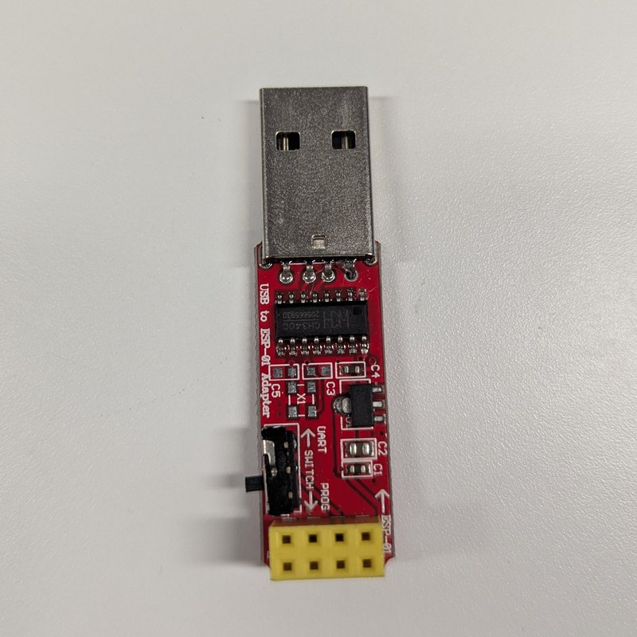<br><sub>USB to ESP-01 Adapter, WCH CH340C</sub> | ESP-01 USB-programmaator: USB-A pistik, 2×4 pesa, lüliti UART/PROG | Püsivara üleslaadimine. Windowsis tuvastatakse kui *USB-SERIAL CH340* (VID 1A86, PID 7523) |
| – | 5 V USB-toiteadapter, vähemalt 0,5 A | Püsitoide |
| – | 2,4 GHz WiFi-võrk internetiühendusega | Side OpenWeatherMapi ja NTP-ga |

## Kontroller ja viigud

ESP8266EX ESP-01S moodulil: Tensilica L106 (80 MHz), ~80 KB RAM, 1 MB välkmälu (programm + LittleFS), WiFi 802.11 b/g/n ainult 2,4 GHz. Viigud on 3,3 V loogikaga ega talu 5 V.

| ESP-01S viik | GPIO | Funktsioon |
|---|---|---|
| IO0 | 0 | OLED SDA |
| IO2 | 2 | OLED SCL. Mooduli sinine LED on samal viigul, seega seda olekunäiduks ei kasutata |
| RXD | 3 | Nupp KEY1 (GND-sse, sisemine pull-up). Seetõttu töötab Serial ainult saatmiseks |
| TXD | 1 | Silumislogi (115200 baud, ainult USB-UART-adapteriga) |

GPIO0 ja GPIO2 peavad käivitusel olema kõrgel tasemel. Seda tagavad OLED-mooduli pull-up-takistid, seega peab ekraan käivitamisel ühendatud olema.

## Sisendid ja väljundid

| Liik | Nimi | Kirjeldus |
|---|---|---|
| Sisend | Nupp KEY1 | 5 s hoidmine kustutab seadistused ja taaskäivitab seadme |
| Sisend | Veebivorm `/config` → `/save` | WiFi nimi ja parool, linn, API võti, uuendusintervall (2–1440 min), ajavöönd, suveaeg |
| Sisend | OpenWeatherMap (HTTPS) | Temperatuur, niiskus, rõhk, tuul, kirjeldus |
| Sisend | NTP (`pool.ntp.org`) | Kellaaeg |
| Väljund | OLED | 10 s ilmavaade (linn, kell, temperatuur, kirjeldus, niiskus, rõhk, tuul), 5 s olekuvaade (WiFi, IP, API). AP-režiimis seadistusjuhis |
| Väljund | Avaleht `/` | Ilmaandmed, olek, viimase uuenduse aeg. Uueneb iga 30 s |
| Väljund | `/api/status` | Kõik andmed JSON-ina (nt koduautomaatika jaoks) |
| Väljund | Serial (TX) | Ühenduse, seadistuse ja API päringute logi |

## Toide, side ja andmete hoidmine

**Toide.** 5 V micro-USB pesast P2, AMS1117-3.3 annab 3,3 V ESP-01S-ile ja OLED-ile. Voolutarve on ligikaudu 70–200 mA WiFi saatmisel ja kuni ~20 mA OLED-il, seega piisab 0,5 A adapterist.

**Side.**

- WiFi kliendina (STA) põhivõrku. Ühenduse puudumisel pääsupunkt `ESP_AP` (WPA2) ja captive portal aadressil 192.168.4.1.
- HTTPS päringud `api.openweathermap.org` (port 443), vt [Turvalisus](#turvalisus).
- NTP (UDP 123), ajavöönd ja EL-i suveaeg arvestatakse programmis.
- mDNS nimi `ilmajaam.local`.

**Andmete hoidmine.** Seadistused on LittleFS-i failis `/config.json`. Kirjutamine käib ajutise faili kaudu, nii et voolukatkestus salvestamise ajal ei riku olemasolevat faili. Veebiliides ei näita salvestatud parooli ega API võtit.

**Konfigureeritavad konstandid** (koodi alguses):

| Konstant | Vaikeväärtus | Tähendus |
|---|---|---|
| `AP_SSID` / `AP_PASS` | `ESP_AP` / vt koodi | Seadistusvõrgu nimi ja parool. Muuda parool enne kasutuselevõttu |
| `ADMIN_PASS` | tühi | Kui määratud, nõuavad seadistuslehed parooli (kasutaja `admin`) |
| `HOST_NAME` | `ilmajaam` | mDNS nimi |
| `OLED_FLIP` | `true` | Muuda `false`-ks, kui tekst on tagurpidi |

## Nõuded

**Funktsionaalsed**

| Nr | Nõue | Lahendus |
|---|---|---|
| F1 | Automaatne ühendumine salvestatud WiFi-võrku | `connectSTA()`, katkestuse korral `staWatchdogTick()` |
| F2 | Ühenduse või seadistuse puudumisel käivitub AP `ESP_AP` | `startAP()` |
| F3 | AP-režiimis on veebiliides kättesaadav | Veebiserver ja captive portal, 192.168.4.1 |
| F4 | WiFi, linna ja API võtme sisestamine veebis | `/config`, `handleSave()` |
| F5 | Seadistused säilivad taaskäivitusel | `saveConfig()`, `loadConfig()` |
| F6 | Kuvatakse temperatuur, niiskus, rõhk, tuul ja kirjeldus | `fetchWeather()`, `oledTick()`, `handleRoot()` |
| F7 | Ilmaandmed uuenevad automaatselt | `weatherTick()`, intervall 2–1440 min |
| F8 | API vead ei jooksuta seadet kokku | Kõik veaharud käsitletud, uus katse 60 s pärast |
| F9 | Kellaaeg sünkroonitakse NTP-ga | `ntpTick()` |
| F10 | Kuvatakse viimase eduka uuenduse aeg | `lastOkEpoch` |
| F11 | Kuvatakse WiFi ja API olek | OLED, avaleht, `/api/status` |
| F12 | Töö taastub pärast voolukatkestust iseseisvalt | `apRetryTick()` proovib AP-režiimis põhivõrku iga 2 min |
| F13 | Ilmaandmete ajalugu salvestatakse Google Sheetsi | `logToSheet()`, Apps Script veebirakendus, vt [Kiirstart](#4-ilmaandmete-ajalugu-google-sheetsis-valikuline) |

**Mittefunktsionaalsed**

- **Turvalisus:** parool ja API võti on veebis peidetud, AP on WPA2-ga, valikuline `ADMIN_PASS`. Piirangud vt [Turvalisus](#turvalisus).
- **Töökindlus:** atomaarne seadistuse salvestus, enne API päringut kontrollitakse vaba mälu (≥ 14 KB).
- **Kasutatavus:** SSID valik leitud võrkude loendist, `ilmajaam.local`, IP ja olek ekraanil, nupuga lähtestamine.
- **Hooldatavus:** kommenteeritud kood, seaded konstantidena faili alguses.

## Ühendusskeem

Kõik ühendused on HU-061 trükkplaadil, väliseid juhtmeid pole vaja (skeem tootja juhendist):

```text
 P2 USB                U1 AMS1117-3.3
 VBUS (5 V) ──┬───┬─── Vin      Vout ───┬───┬──── VCC (3,3 V)
              │   │         GND         │   │
             BAT1 C1 10µF    │          C2 10µF
              │   │          │          │   │
 GND ─────────┴───┴──────────┴──────────┴───┴──── GND

 JP1 OLED (SSD1306)         P1 ESP-01S
 1 GND  ── GND              1 GND  ── GND        8 TXD   ── (silumine)
 2 VCC  ── VCC              2 IO2  ── OLED SCL   7 CH_PD ── VCC
 3 SCL  ── IO2 (GPIO2)      3 IO0  ── OLED SDA   6 RST   ── (ühendamata)
 4 SDA  ── IO0 (GPIO0)      4 RXD  ── KEY1 ──┐   5 VCC   ── VCC
                                             GND
```

## Veaotsing

| Sümptom | Põhjus ja lahendus |
|---|---|
| `Failed to connect to ESP8266: Timed out` | Moodul ei käivitunud programmeerimisrežiimis. Lüliti PROG-asendisse ja programmaator uuesti USB-sse |
| Arduino IDE-s pole plaati *Generic ESP8266 Module* | ESP8266 pakett on paigaldamata, vt [Kiirstart](#kiirstart) |
| Ekraan jääb tühjaks | Moodul on plaadil vales suunas või OLED pole korralikult joodetud |
| Tekst on tagurpidi | `OLED_FLIP = false` |
| „Vigane API võti (401)” | Võti on vale või veel aktiveerimata (kuni mõni tund pärast loomist) |
| „Linna ei leitud (404)” | Lisa riigikood, nt `Tartu,EE` |
| „Salvestamine ebaõnnestus” | Flash Size valikus puudub failisüsteem. Vali `1MB (FS:64KB OTA:~470KB)` |
| Seade ei leia WiFi-võrku | ESP8266 toetab ainult 2,4 GHz võrke |

## Teadaolevad piirangud

- OpenWeatherMap ei toeta eesti keelt (`lang=et`), seega on ilmakirjeldus inglise keeles.
- Linna järgi päring (`q=`) on OpenWeatherMapis märgitud aegunuks, kuid töötab. Tulevikukindlam on Geocoding API ja koordinaadid.
- Tasuta plaani limiit on 60 päringut minutis ja 1 000 000 kuus. Minimaalne 2-minutiline intervall jääb sellest kaugele alla.

## Dokumentatsioon ja andmelehed

| Komponent | Tootja | Dokument |
|---|---|---|
| HU-061 komplekt | Tootja nime ei avaldata | [Tootja juhend (PDF, komponendid ja jootmine)](http://myosuploads3.banggood.com/products/20240423/20240423034843HU-061WeatherClock.pdf) · [Ajavööndi muutmise õpetus tehase püsivarale (QR-kood, WeChat)](https://mp.weixin.qq.com/s/EPzJDI3mexVzFEDmF4cRRg) |
| ESP8266EX | Espressif | [ESP8266EX Datasheet](https://espressif.com/sites/default/files/documentation/0a-esp8266ex_datasheet_en.pdf) |
| ESP-01S | Ai-Thinker | [ESP-01S andmeleht](https://assets.ebee.com/datasheet/2409231126_Ai-Thinker-ESP-01S_C503582.pdf) |
| SSD1306 | Solomon Systech | [SSD1306 andmeleht](https://www.crystalfontz.com/controllers/SSD1306) |
| AMS1117-3.3 | Advanced Monolithic Systems | [AMS1117 andmeleht](http://www.advanced-monolithic.com/pdf/ds1117.pdf) |
| CH340 | WCH | [CH340 tooteleht, andmeleht ja draiverid](https://www.wch-ic.com/products/CH340.html) |
| ESP8266 Arduino core | ESP8266 Community | [Dokumentatsioon](https://arduino-esp8266.readthedocs.io/) |
| OpenWeatherMap API | OpenWeather | [Current Weather API](https://openweathermap.org/current) |

## Tunnipäevik

| Kuupäev | Töö |
|---|---|
| 2026-10-21 | Projekti algus. Teema valik, GitHubi repositooriumi loomine, dokumentatsiooni esialgne struktuur |
| 2026-10-22 | Dokumentatsiooni kohandamine HU-061 komplektile: komponendid, viigud, ühendusskeem, nõuded |
| 2026-10-28 | Vahenädal |
| 2026-11-04 | Programmaatori tuvastamine (CH340, COM3) ja Arduino IDE seadistamine (esp8266 3.1.2). Esimene püsivara üleslaadimine ESP-01S-ile (olemasolev testkood + hotspot), OLED-ekraani test HU-061 plaadil. Ühe uue ilmajaama komplekti kokkujootmine (Tanel). Dokumentatsiooni ülevaatus ja parandused (Uku). |
| 2026-11-11 | Teise ilmajaama komplekti kokkujootmine. Püsivara lõpetamine ja testimine: seade ühendub WiFi-ga ning kuvab OLED-il Tartu ilmaandmeid ja kellaaega. Koodile kommentaaride lisamine ja README uuendus. |
| 2026-11-18 | Mõlema kokkujoodetud ilmajaama funktsionaalsuse ülekontrollimine, komplektide täielik kokkupanek (akrüülikust korpuse), Google Sheets-ga integreerimine (Tanel). |
| 2026-11-25 | Readme korrastamine, üldine viimistlus, Google Sheets'i keskkonda andmete lugemisel abistavate graafikute lisamine |

## Koodinäide

Täielik kommenteeritud lähtekood on failis [`code/weather_station.ino`](code/weather_station.ino). Allolev lihtsustatud näide näitab põhiideed: ühendumine WiFi-ga, ilmaandmete pärimine ja kuvamine OLED-ekraanil. Seadistuste veebiliides, AP-režiim ja veakäsitlus on näitest välja jäetud.

```cpp
#include <ESP8266WiFi.h>
#include <ESP8266HTTPClient.h>
#include <WiFiClientSecure.h>
#include <ArduinoJson.h>
#include <SSD1306Wire.h>

const char* WIFI_SSID = "minuvõrk";
const char* WIFI_PASS = "parool";
const char* API_KEY   = "openweathermap-võti";

SSD1306Wire display(0x3C, 0, 2);   // HU-061: SDA = GPIO0, SCL = GPIO2

void setup() {
  display.init();
  display.flipScreenVertically();
  display.drawString(0, 0, "Ühendun...");
  display.display();

  WiFi.begin(WIFI_SSID, WIFI_PASS);
  while (WiFi.status() != WL_CONNECTED) delay(250);
}

void loop() {
  WiFiClientSecure client;
  client.setInsecure();   // lihtsustus, vt jaotist "Turvalisus"

  HTTPClient http;
  http.begin(client, String("https://api.openweathermap.org/data/2.5/weather"
                            "?q=Tallinn,EE&units=metric&appid=") + API_KEY);

  if (http.GET() == HTTP_CODE_OK) {
    JsonDocument doc;
    deserializeJson(doc, http.getString());

    display.clear();
    display.setFont(ArialMT_Plain_10);
    display.drawString(0, 0, doc["name"].as<String>());
    display.setFont(ArialMT_Plain_24);
    display.drawString(0, 16, String(doc["main"]["temp"].as<float>(), 1) + " °C");
    display.setFont(ArialMT_Plain_10);
    display.drawString(0, 48, doc["weather"][0]["description"].as<String>());
    display.display();
  }
  http.end();

  delay(10UL * 60 * 1000);   // uuendus iga 10 minuti järel
}
```
